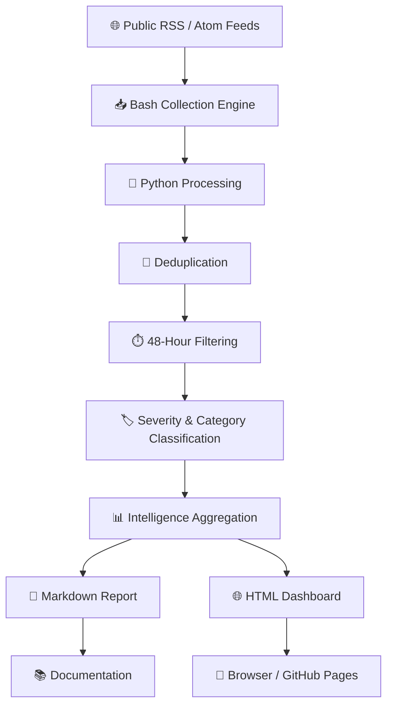

# 🛡️ Cybersecurity Intelligence Dashboard

<p align="center">
  
  
  
</p>

<p align="center">
  <strong>A lightweight Cyber Threat Intelligence and IT Operations Monitoring platform.</strong>
  <br />
  Aggregating cybersecurity threats, vulnerabilities, vendor advisories, cloud incidents, and service availability into one centralized intelligence dashboard.
</p>

<p align="center">
  
  
  
  
  
</p>

---

## 📊 Overview

The **Cybersecurity Intelligence Dashboard** is an automated intelligence aggregation and reporting tool designed to provide IT operations, infrastructure, and cybersecurity professionals with a consolidated view of the latest security developments.

It collects information from trusted public RSS/Atom feeds and service-status platforms, processes the collected intelligence, identifies duplicates, classifies findings by severity, and generates two reports:

- 🌐 **HTML Dashboard** — Interactive, searchable, and responsive intelligence interface.
- 📝 **Markdown Report** — Lightweight intelligence summary suitable for documentation and GitHub.

The objective is simple: **turn fragmented security information into actionable operational awareness.**

## ✨ Key Features

| Feature | Description |
|:---|:---|
| 🔍 Intelligence Collection | Automated collection from cybersecurity and technology feeds |
| 🚨 Threat Classification | Severity classification: Critical, High, Medium, Info |
| 🧹 Deduplication | Removes duplicate headlines and redundant entries |
| ⏱️ Time Filtering | Focuses on intelligence published within the last 48 hours |
| 🏷️ Categorization | Organizes information by technology and security domain |
| 📈 Executive Overview | KPI cards and intelligence summary statistics |
| 🔎 Search & Filtering | Search and filter collected intelligence |
| 🌙 Theme Support | Dark and light dashboard themes |
| 📱 Responsive Design | Desktop, tablet, and mobile-friendly interface |
| 🔗 Source Attribution | Direct links to original articles and advisories |
| 📄 Multiple Formats | Generates HTML and Markdown reports |
| 🚀 Static Hosting | Compatible with GitHub Pages and other static hosting platforms |

---

## 🌍 Intelligence Sources

The dashboard consolidates intelligence from multiple technology vendors, cloud providers, and independent cybersecurity publications.

### ☁️ Cloud & Infrastructure Providers

- Microsoft Azure
- Amazon Web Services (AWS)
- Google Cloud Platform (GCP)
- Cloudflare
- GitHub
- OpenAI

### 💼 SaaS & Enterprise Applications

- Microsoft 365 / Outlook
- Atlassian
- Slack
- Zoom

### 🔐 Cybersecurity & Threat Intelligence

- [BleepingComputer](https://www.bleepingcomputer.com/)
- [The Hacker News](https://thehackernews.com/)
- [Krebs on Security](https://krebsonsecurity.com/)
- [CISA](https://www.cisa.gov/)
- [SANS Internet Storm Center](https://isc.sans.edu/)
- [The Register](https://www.theregister.com/)
- [Ars Technica](https://arstechnica.com/)

---

## 🚨 Threat Severity Classification

Each collected intelligence item is assigned a severity level based on keyword-driven classification logic.

| Severity | Indicator | Description |
|:---|:---:|:---|
| 🔴 **CRITICAL** |  | Critical vulnerabilities, active exploitation, major security incidents, and severe service disruptions |
| 🟠 **HIGH** |  | Significant vulnerabilities, security advisories, exploitation attempts, and high-impact incidents |
| 🟡 **MEDIUM** |  | Security weaknesses, technology updates, and operational issues requiring attention |
| 🔵 **INFO** |  | General security news, vendor announcements, technology developments, and informational updates |

> **Important:** Severity is assigned through keyword-based analysis. It is an automated prioritization indicator, not a verified CVSS score or formal risk assessment.

## 🗂️ Intelligence Categories

Collected information is organized into the following operational domains:

| Category | Scope |
|:---|:---|
| 🔐 Cybersecurity | Vulnerabilities, exploits, malware, ransomware, and security advisories |
| ☁️ Cloud | Azure, AWS, GCP, Cloudflare, and cloud infrastructure incidents |
| 🖥️ Infrastructure | Network infrastructure, systems, datacenters, and operational incidents |
| 💼 SaaS / Applications | Enterprise applications, collaboration platforms, and SaaS availability |
| 📧 Microsoft 365 / Outlook | Microsoft 365 services, Exchange Online, Outlook, and related incidents |

---

## 🖥️ Dashboard Capabilities

The generated HTML dashboard provides an enterprise-style interface for reviewing cybersecurity and IT operational intelligence.

### 📈 Executive Intelligence Overview

- Total collected intelligence items.
- Severity distribution.
- Category distribution.
- Threat and vulnerability overview.
- Cloud and SaaS service status information.

### 🔎 Intelligence Search & Investigation

- Search headlines and descriptions.
- Filter intelligence by severity.
- Filter by category.
- Review original publication sources.
- Open original advisories and articles directly.

### 🎨 User Experience

- Professional enterprise/SOC-inspired interface.
- Dark and light display modes.
- Responsive layout.
- Clear visual severity indicators.
- Structured intelligence cards and summary panels.

---

## ⚙️ How It Works

The architecture is intentionally lightweight and does not require a database, backend API, or external application server.



### Processing Workflow

1. **Feed Collection** — Reads configured RSS/Atom feeds and public service-status sources.
2. **Metadata Extraction** — Parses headlines, publication dates, descriptions, and original URLs.
3. **Time Filtering** — Retains entries published within the last 48 hours.
4. **Deduplication** — Identifies and removes duplicate headlines.
5. **Severity Analysis** — Applies keyword-based classification.
6. **Category Mapping** — Assigns each item to its corresponding technology or security domain.
7. **Intelligence Aggregation** — Calculates summary statistics and executive KPIs.
8. **Report Generation** — Produces Markdown and standalone HTML reports.

---

## 📁 Project Structure

```text
cybersecurity-intelligence-dashboard/
│
├── 📄 README.md
│
├── ⚙️ dailynews.sh
│   └── Main collection and reporting script
│
├── 📝 dailynews.md
│   └── Generated Markdown intelligence report
│
└── 🌐 dailynews.html
    └── Generated interactive HTML dashboard
```

## 🛠️ Requirements

| Component | Requirement |
|:---|:---|
| Operating System | Linux / WSL |
| Shell | Bash |
| Processing | Python 3 |
| Connectivity | Internet access |
| Output | HTML5 and Markdown |
| Browser | Modern web browser |

No database or dedicated backend infrastructure is required.

---

## 🚀 Installation & Usage

### 1. Clone the Repository

```bash
git clone https://github.com/USERNAME/cybersecurity-intelligence-dashboard.git

cd cybersecurity-intelligence-dashboard
```

### 2. Run the Collection Script

```bash
bash ./dailynews.sh
```

### 3. Open the Generated Dashboard

```bash
xdg-open dailynews.html
```

The script regenerates the Markdown and HTML reports using the latest available information from the configured sources.

---

## 🌐 GitHub Pages Deployment

The dashboard is generated as a standalone HTML file, making it suitable for static hosting.

### Option 1 — Publish the Repository Root

Configure GitHub Pages to publish directly from the repository root.

### Option 2 — Publish Through the `docs/` Directory

Create the documentation directory:

```bash
mkdir -p docs
```

Copy the generated dashboard:

```bash
cp dailynews.html docs/index.html
```

Commit and push:

```bash
git add .
git commit -m "Update cybersecurity intelligence dashboard"
git push
```

Then configure:

**GitHub → Repository → Settings → Pages**

- Source: Deploy from a branch
- Branch: `main`
- Folder: `/docs`

Your dashboard will be available through your GitHub Pages URL.

---

## 🎯 Use Cases

| Use Case | Operational Value |
|:---|:---|
| 🛡️ SOC Monitoring | Daily cybersecurity threat awareness |
| 🔍 Vulnerability Monitoring | Track newly published vulnerabilities and advisories |
| ☁️ Cloud Operations | Monitor cloud provider incidents and availability |
| 🏢 IT Operations | Consolidated vendor and infrastructure monitoring |
| 📊 Executive Reporting | Quickly communicate security developments |
| 🔔 Threat Awareness | Identify potentially important security developments |

---

## 🔒 Security & Operational Considerations

- Uses publicly accessible information sources.
- Does not require storing intelligence in an external database.
- Maintains direct links to original publications.
- Does not independently verify vulnerabilities or incidents.
- Classification is based on predefined keyword rules.
- Information should be validated against original vendor advisories before operational decisions are made.
- GitHub Pages content is publicly accessible when published through a public repository.

**This dashboard is an intelligence aggregation tool, not a replacement for SIEM, SOAR, vulnerability management, or dedicated threat intelligence platforms.**

---

## 🔮 Future Development

Potential improvements for future releases:

- [ ] MITRE ATT&CK framework mapping.
- [ ] CVE and CVSS enrichment.
- [ ] CISA Known Exploited Vulnerabilities (KEV) integration.
- [ ] EPSS vulnerability exploitation probability.
- [ ] Vendor-specific advisory tracking.
- [ ] Advanced filtering by CVE, vendor, and technology.
- [ ] Automated scheduled collection.
- [ ] Historical intelligence tracking.
- [ ] Email and notification integrations.
- [ ] RSS feed export.
- [ ] GitHub Actions automation.
- [ ] Threat intelligence trend analysis.

---

## 🤝 Contributing

Contributions and improvements are welcome.

You can extend the project by:

- Adding new intelligence sources.
- Improving severity classification.
- Introducing additional technology categories.
- Enhancing dashboard visualization.
- Improving collection and deduplication logic.
- Adding new threat intelligence integrations.

The project is designed to remain lightweight, modular, and easy to extend.

---

## 📜 License

Provided as-is for operational monitoring, educational purposes, and internal use.

Ensure compliance with the licensing, attribution, and redistribution requirements of all external intelligence sources.

---

<p align="center">
  <strong>🛡️ Cybersecurity Intelligence Dashboard</strong>
  <br />
  <sub>Monitor. Analyze. Understand. Stay Informed.</sub>
  <br /><br />
  
</p>